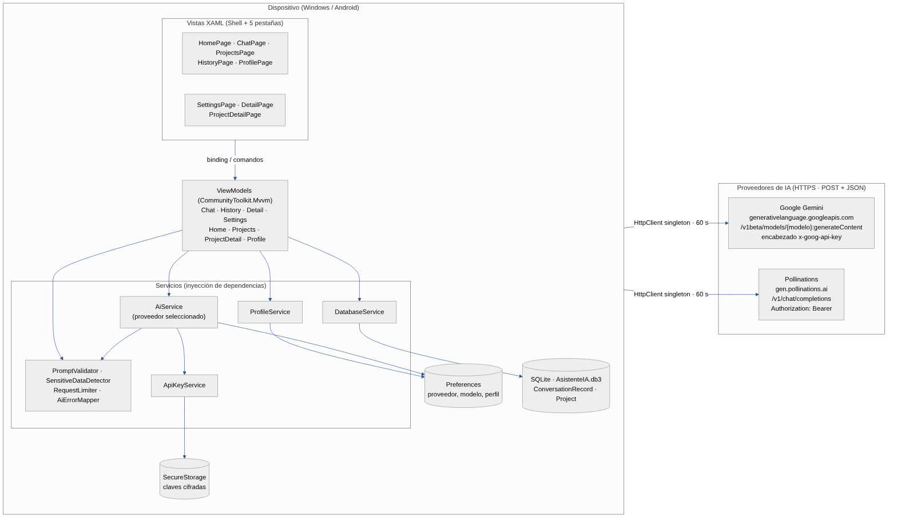

# 01. Diagrama de arquitectura del sistema

*Fuente editable: [`diagramas/fuentes/arquitectura.mmd`](diagramas/fuentes/arquitectura.mmd) (Mermaid).*

## Componentes

| Capa | Componentes | Responsabilidad | Se comunica con |
|---|---|---|---|
| Vistas (XAML + Shell) | 5 pestañas: Inicio, Consultar, Proyectos, Historial, Perfil. Rutas secundarias: Configuración, Detalle, Detalle de proyecto. | Mostrar datos y capturar acciones. No hacen solicitudes HTTP. | ViewModels por *binding* y comandos. |
| ViewModels (MVVM) | `HomeViewModel`, `ChatViewModel`, `ProjectsViewModel`, `ProjectDetailViewModel`, `HistoryViewModel`, `DetailViewModel`, `ProfileViewModel`, `SettingsViewModel`. | Estado observable, validación, comandos. | Servicios inyectados por constructor. |
| Servicios | `AiService`, `ApiKeyService`, `DatabaseService`, `ProfileService`, `INavigationService`, `IDialogService`. | Acceso a la API de IA, almacenamiento seguro, SQLite, preferencias, navegación. | APIs externas y almacenes locales. |
| Lógica pura | `PromptValidator`, `SensitiveDataDetector`, `RequestLimiter`, `AiErrorMapper`, `AiProviderCatalog`. | Reglas sin dependencia de MAUI; probadas con xUnit. | — |
| Almacenamiento local | SQLite (`AsistenteIA.db3`), `SecureStorage`, `Preferences`. | Historial y proyectos; claves cifradas; proveedor, modelo y perfil. | Solo el dispositivo. |
| Proveedores de IA | Google Gemini · Pollinations. | Generar la respuesta. | HTTPS, `POST` + JSON, `HttpClient` único (60 s). |

## Comunicación

1. **Vista → ViewModel:** *data binding* (`{Binding}`) y comandos generados con `[RelayCommand]`.
2. **ViewModel → AiService:** `AskAsync(prompt, …, CancellationToken)`; asíncrono, no bloquea la interfaz.
3. **AiService → proveedor:** según el proveedor guardado en `Preferences` arma el `POST` de Gemini (`generateContent`) o de Pollinations (`chat/completions`). La clave se lee de `SecureStorage` y viaja en un encabezado.
4. **ViewModel → DatabaseService → SQLite:** al pulsar *Guardar*, *Verificar*, *Nota* o *Eliminar*.
5. **Inyección de dependencias** (`MauiProgram.cs`): servicios *singleton*, ViewModels y páginas *transient*.
