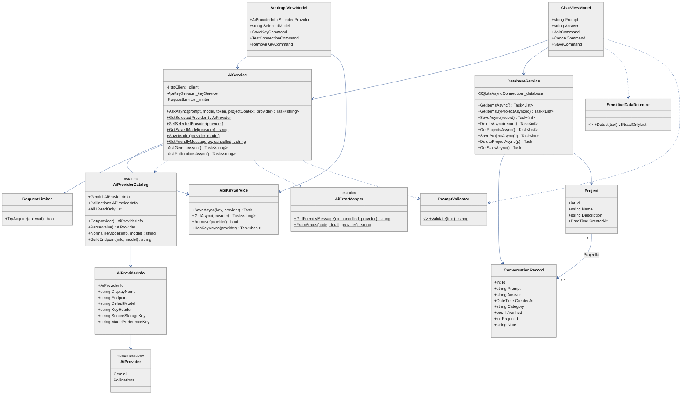

# 02. Diagrama de clases

*Fuente editable: [`diagramas/fuentes/clases.mmd`](diagramas/fuentes/clases.mmd).*

## Clases principales

| Clase | Tipo | Atributos / propiedades clave | Métodos clave | Responsabilidad |
|---|---|---|---|---|
| `AiService` | Servicio (singleton) | `_client` (HttpClient), `_keyService`, `_limiter`; constantes `MaxOutputTokens = 4096`, `MaxPromptLength = 2000` | `AskAsync`, `GetSelectedProvider`, `SetSelectedProvider`, `GetSavedModel`, `SaveModel`, `GetFriendlyMessage` | Validar, comprobar red/clave/límite y enviar la consulta al proveedor elegido. |
| `AiProviderCatalog` / `AiProviderInfo` / `AiProvider` | Lógica pura | Endpoint, modelo por defecto, modelos sugeridos, encabezado de clave, nombre en SecureStorage y Preferences | `Get`, `Parse`, `NormalizeModel`, `BuildEndpoint` | Describir cada proveedor en un solo lugar. |
| `AiErrorMapper` | Lógica pura (estática) | — | `GetFriendlyMessage`, `FromStatus` | Convertir excepciones y códigos HTTP en mensajes en español sin la clave. |
| `ApiKeyService` | Servicio | — | `SaveAsync`, `GetAsync`, `Remove`, `HasKeyAsync` (por proveedor) | Guardar la clave en `SecureStorage`. |
| `DatabaseService` | Servicio | `_database` (SQLiteAsyncConnection, inicialización perezosa) | CRUD de `ConversationRecord` y `Project`, `GetStatsAsync` | Persistencia local. |
| `ProfileService` | Servicio | Claves de Preferences | `Load`, `Save`, `Clear`, `NoticeAccepted` | Perfil del estudiante y aviso de uso responsable. |
| `PromptValidator` | Lógica pura | `MinLength = 5`, `MaxLength = 2000` | `Validate` | RF02. |
| `SensitiveDataDetector` | Lógica pura | Expresiones regulares con *timeout* de 200 ms | `Detect`, `PassesLuhn` | Avisar de correos, tarjetas, teléfonos, credenciales y claves. |
| `RequestLimiter` | Lógica | Máx. 8 solicitudes por minuto | `TryAcquire(out wait)` | Proteger la cuota de la clave. |
| `ConversationRecord`, `Project` | Entidades SQLite | Ver diccionario de datos | Propiedades de presentación con `[Ignore]` | Datos persistentes. |
| `ChatModels` | DTO JSON | `ChatRequest`/`ChatResponse` (Gemini), `OpenAiChatRequest`/`OpenAiChatResponse` (Pollinations) | — | Serialización con `System.Text.Json`. |
| ViewModels | `ObservableObject` | `[ObservableProperty]` | `[RelayCommand]` | Estado y comandos de cada pantalla. |

## Relaciones

- **Composición por inyección:** `ChatViewModel → AiService, DatabaseService, IDialogService`; `SettingsViewModel → ApiKeyService, AiService`; `AiService → HttpClient, ApiKeyService, RequestLimiter`.
- **Dependencias de uso:** `AiService` usa `AiProviderCatalog`, `PromptValidator` y `AiErrorMapper`; `ChatViewModel` usa `SensitiveDataDetector`.
- **Asociación de datos:** un `Project` agrupa 0..* `ConversationRecord` mediante `ProjectId` (0 = sin proyecto).
