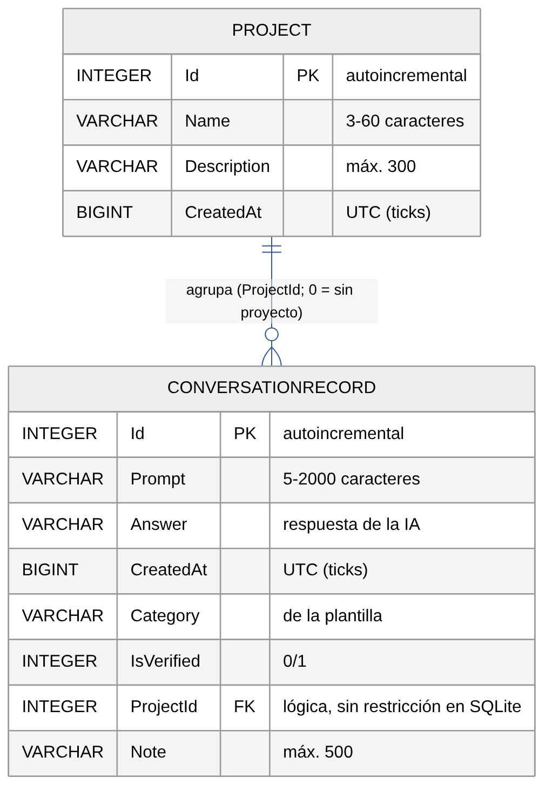

# 03. Modelo entidad-relación (SQLite)



*Fuente editable: [`diagramas/fuentes/erd.mmd`](diagramas/fuentes/erd.mmd).*

- **Base de datos:** archivo `AsistenteIA.db3` en `FileSystem.AppDataDirectory` (carpeta privada de la app).
- **Biblioteca:** `sqlite-net-pcl` 1.9.172 con `SQLitePCLRaw.bundle_green` 2.1.10. Las tablas se crean con `CreateTableAsync<T>()`, que también agrega columnas nuevas a bases existentes.

## Tablas

| Tabla | Clave primaria | Claves foráneas | Descripción |
|---|---|---|---|
| `Project` | `Id` (INTEGER, autoincremental) | — | Materia, taller o trabajo que agrupa consultas. |
| `ConversationRecord` | `Id` (INTEGER, autoincremental) | `ProjectId → Project.Id` (**lógica**) | Consulta guardada con su respuesta. |

## Relación

| Relación | Cardinalidad | Regla |
|---|---|---|
| `Project` agrupa `ConversationRecord` | 1 : 0..* | `ProjectId = 0` significa «sin proyecto». |

**Integridad referencial:** sqlite-net no crea restricciones `FOREIGN KEY`. La integridad la mantiene `DatabaseService.DeleteProjectAsync`: antes de borrar un proyecto ejecuta `UPDATE ConversationRecord SET ProjectId = 0 WHERE ProjectId = ?`, así las consultas se conservan sin proyecto.

## SQL equivalente (generado por sqlite-net)

```sql
CREATE TABLE "Project" (
  "Id" INTEGER PRIMARY KEY AUTOINCREMENT NOT NULL,
  "Name" VARCHAR, "Description" VARCHAR, "CreatedAt" BIGINT);

CREATE TABLE "ConversationRecord" (
  "Id" INTEGER PRIMARY KEY AUTOINCREMENT NOT NULL,
  "Prompt" VARCHAR, "Answer" VARCHAR, "CreatedAt" BIGINT,
  "Category" VARCHAR, "IsVerified" INTEGER, "ProjectId" INTEGER, "Note" VARCHAR);
```
