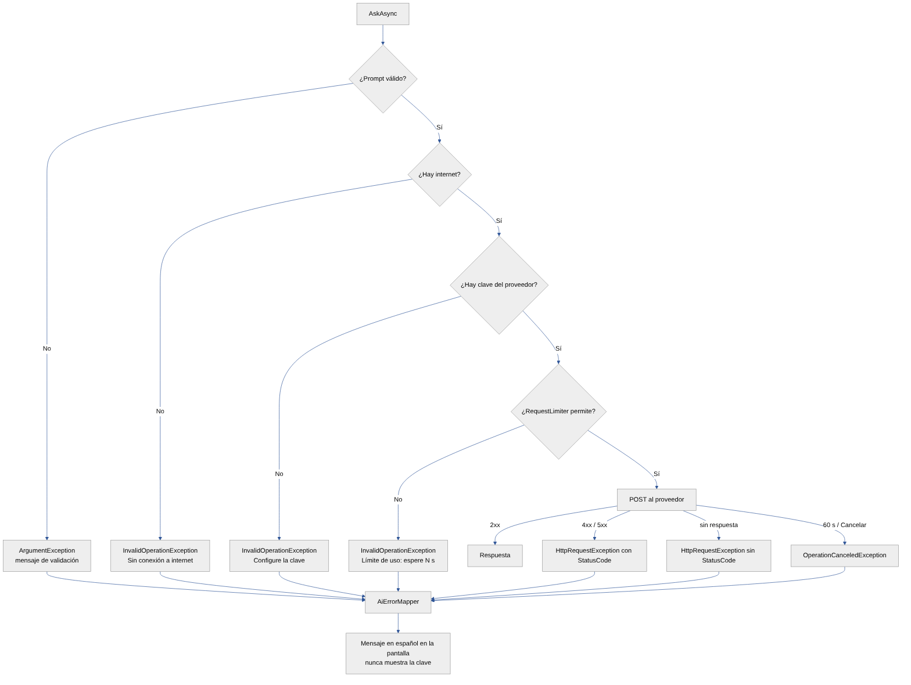

# 08. Gestión de errores y excepciones

Todas las excepciones terminan en **`AiErrorMapper.GetFriendlyMessage`** (lógica pura, probada con 16 pruebas), que
devuelve un mensaje en español **sin la clave**. La interfaz nunca se cierra: el ViewModel captura la excepción,
muestra el mensaje en `StatusMessage` y deja los botones activos.

## 8.1 Errores antes de enviar

| Situación | Excepción | Mensaje |
|---|---|---|
| Consulta vacía | `ArgumentException` | «Escriba una consulta antes de enviar.» |
| Menos de 5 / más de 2000 caracteres | `ArgumentException` | «La consulta es demasiado corta (mínimo 5 caracteres).» / «La consulta supera 2000 caracteres.» |
| Sin internet (`Connectivity.NetworkAccess`) | `InvalidOperationException` | «Sin conexión a internet. Verifique su red e intente de nuevo.» |
| Sin clave del proveedor | `InvalidOperationException` | «Configure la clave de {proveedor} en Perfil › Configuración.» |
| Más de 8 consultas por minuto | `InvalidOperationException` | «Límite de uso alcanzado: espere N s…» |
| Datos sensibles detectados | (diálogo, no excepción) | El usuario decide *Enviar* o *Revisar*. |

## 8.2 Errores HTTP

| Código | Causa típica | Mensaje | Acción sugerida |
|---|---|---|---|
| 400 | Gemini: clave inválida («API key») o cuerpo/modelo inválido | «Error de autorización (400)…» o «Solicitud rechazada (400). Revise el modelo…» | Revisar clave o modelo. |
| 401 | Clave ausente o inválida | «Error de autorización (401): la clave de {proveedor} es inválida…» | Guardar una clave nueva. |
| 402 | Pollinations sin saldo o límite gratuito | «{proveedor} rechazó la solicitud por saldo o límite gratuito (402)…» | Revisar la cuenta o cambiar de proveedor. |
| 403 | Clave sin permisos / API no habilitada | «Error de autorización (403)…» | Revisar permisos del proyecto. |
| 404 | Modelo inexistente o retirado | «Modelo no encontrado (404). Cambie el modelo en Configuración.» | Elegir un modelo sugerido. |
| **408** | El servidor agotó su tiempo de espera | «El servidor tardó demasiado en responder (408)…» | Reintentar. *(Nuevo: no se manejaba.)* |
| 429 | Cuota o límite por minuto | «Se superó la cuota o el límite de solicitudes (429)…» | Esperar. |
| 500–599 | Falla del proveedor | «El servicio de IA no está disponible (código)…» | Reintentar más tarde o cambiar de proveedor. |
| Otro | — | «Error del servicio: código.» | — |

## 8.3 Problemas de conexión y tiempo

| Situación | Excepción | Mensaje |
|---|---|---|
| DNS, TLS o servidor inalcanzable | `HttpRequestException` sin `StatusCode` | «No se pudo conectar con el servicio. Verifique su conexión.» |
| Se superan los 60 s del `HttpClient` | `TaskCanceledException` / `TimeoutException` | «Tiempo de espera agotado. Intente de nuevo.» |
| El usuario pulsa **Cancelar** | `OperationCanceledException` con el token cancelado | «Consulta cancelada.» |
| Respuesta 200 sin texto | — | «El servicio no devolvió contenido.» o «El servicio bloqueó la consulta (motivo)…» |
| Error al guardar en SQLite | `Exception` | «No se pudo guardar localmente: …» |
