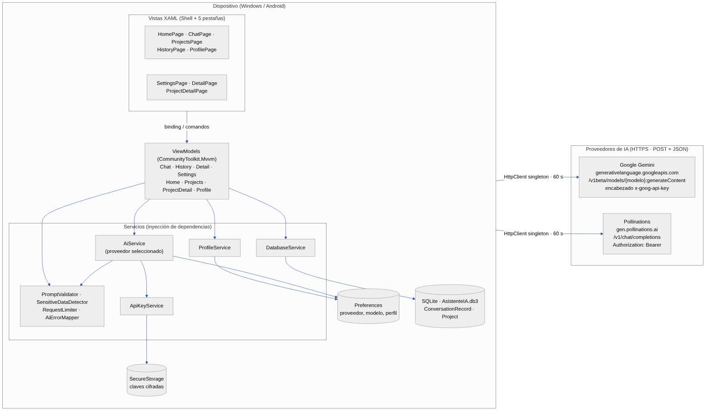

# 5. Arquitectura del sistema

## 5.1 Diagrama de arquitectura

*Figura 1. Arquitectura del sistema (fuente editable: `diagramas/fuentes/arquitectura.mmd`).*

## 5.2 Componentes

| Capa | Componentes | Responsabilidad | Se comunica con |
|---|---|---|---|
| Vistas (XAML + Shell) | 5 pestañas: Inicio, Consultar, Proyectos, Historial, Perfil. Rutas secundarias: Configuración, Detalle, Detalle de proyecto. | Mostrar datos y capturar acciones. No hacen solicitudes HTTP. | ViewModels por *binding* y comandos. |
| ViewModels (MVVM) | `HomeViewModel`, `ChatViewModel`, `ProjectsViewModel`, `ProjectDetailViewModel`, `HistoryViewModel`, `DetailViewModel`, `ProfileViewModel`, `SettingsViewModel`. | Estado observable, validación, comandos. | Servicios inyectados por constructor. |
| Servicios | `AiService`, `ApiKeyService`, `DatabaseService`, `ProfileService`, `INavigationService`, `IDialogService`. | Acceso a la API de IA, almacenamiento seguro, SQLite, preferencias, navegación. | APIs externas y almacenes locales. |
| Lógica pura | `PromptValidator`, `SensitiveDataDetector`, `RequestLimiter`, `AiErrorMapper`, `AiProviderCatalog`. | Reglas sin dependencia de MAUI; probadas con xUnit. | — |
| Almacenamiento local | SQLite (`AsistenteIA.db3`), `SecureStorage`, `Preferences`. | Historial y proyectos; claves cifradas; proveedor, modelo y perfil. | Solo el dispositivo. |
| Proveedores de IA | Google Gemini · Pollinations. | Generar la respuesta. | HTTPS, `POST` + JSON, `HttpClient` único (60 s). |

## 5.3 Comunicación entre componentes

1. **Vista → ViewModel:** *data binding* (`{Binding}`) y comandos generados con `[RelayCommand]`.
2. **ViewModel → AiService:** `AskAsync(prompt, …, CancellationToken)`; asíncrono, no bloquea la interfaz.
3. **AiService → proveedor:** según el proveedor guardado en `Preferences` arma el `POST` de Gemini (`generateContent`) o de Pollinations (`chat/completions`). La clave se lee de `SecureStorage` y viaja en un encabezado.
4. **ViewModel → DatabaseService → SQLite:** al pulsar *Guardar*, *Verificar*, *Nota* o *Eliminar*.
5. **Inyección de dependencias** (`MauiProgram.cs`): servicios *singleton*, ViewModels y páginas *transient*.

## 5.4 Estructura de la solución

| Carpeta | Contenido | Responsabilidad |
|---|---|---|
| Models | `ChatModels` (JSON de Gemini y de Pollinations), `ConversationRecord`, `Project` (entidades SQLite), `PromptTemplate`, `UserProfile`, `AiProvider` | Representar los datos. |
| Services | `AiService`, `AiErrorMapper`, `ApiKeyService`, `DatabaseService`, `ProfileService`, `PromptValidator`, `SensitiveDataDetector`, `RequestLimiter`, `INavigationService`, `IDialogService` | Acceso a la API REST, almacenamiento seguro, base de datos y reglas. |
| ViewModels | `HomeViewModel`, `ChatViewModel`, `ProjectsViewModel`, `ProjectDetailViewModel`, `HistoryViewModel`, `DetailViewModel`, `ProfileViewModel`, `SettingsViewModel` | Estado, comandos y reglas de presentación. |
| Views | `HomePage`, `ChatPage`, `ProjectsPage`, `ProjectDetailPage`, `HistoryPage`, `DetailPage`, `ProfilePage`, `SettingsPage` | Interfaz XAML; solo enlaza datos y comandos. |
| Resources | `Colors.xaml`, `Styles.xaml`, fuentes e imágenes | Estilos y tema visual. |

## 5.5 Recorrido de una consulta

1. **XAML (ChatPage):** el usuario escribe el prompt y pulsa *Consultar*; el editor y los botones están enlazados al ViewModel.
2. **ViewModel (ChatViewModel):** `AskCommand` valida el texto (`PromptValidator`), revisa datos sensibles (`SensitiveDataDetector`), activa el estado de carga y crea un `CancellationTokenSource`.
3. **Servicio (AiService):** comprueba la conectividad, lee el proveedor elegido y su clave de `SecureStorage`, aplica el límite de uso y envía el `POST` con `HttpClient`.
4. **JSON:** el cuerpo y la respuesta se serializan con las clases de `ChatModels` (formato Gemini o formato OpenAI para Pollinations).
5. **ViewModel:** muestra la respuesta o el mensaje de error (`AiErrorMapper`) y habilita *Guardar*.
6. **SQLite (DatabaseService):** al pulsar *Guardar* se inserta un `ConversationRecord`; `HistoryViewModel` lo carga en una `ObservableCollection`.

## 5.6 Inyección de dependencias y navegación

En `MauiProgram.cs` se registra un único `HttpClient` reutilizable (dirección base de Gemini y tiempo máximo de 60 s;
Pollinations usa URL absoluta), los servicios como *singleton* y los ViewModels y páginas como *transient*. Las
páginas reciben su ViewModel por constructor y lo asignan como `BindingContext`.

`AppShell` define una barra de pestañas (Inicio, Consultar, Proyectos, Historial y Perfil). Configuración, Detalle de
consulta y Detalle de proyecto son rutas secundarias registradas con `Routing.RegisterRoute` y se abren con
`GoToAsync`, por ejemplo `GoToAsync(nameof(DetailPage), parámetros)`.

| Pantalla | Tipo | Función |
|---|---|---|
| Inicio | Pestaña | Saludo, accesos rápidos, recomendaciones; aviso de uso responsable la primera vez |
| Consultar | Pestaña | Plantilla, proyecto, consulta, respuesta, guardar y cancelar |
| Proyectos | Pestaña | Lista de proyectos y botón para crear |
| Historial | Pestaña | Búsqueda, filtro de verificadas, eliminar |
| Perfil | Pestaña | Datos personales, estadísticas, privacidad |
| Detalle de consulta | Secundaria | Respuesta completa, nota, verificar, eliminar |
| Detalle de proyecto | Secundaria | Crear, editar y eliminar proyecto; sus consultas |
| Configuración y Acerca de | Secundaria | Proveedor, clave, modelo, probar conexión, autoría, privacidad, límites |

## 5.7 Decisiones técnicas

| Decisión | Alternativa | Justificación |
|---|---|---|
| .NET MAUI + Shell | Xamarin, WPF | Un proyecto para Windows y Android; Shell da pestañas y rutas. |
| Dos proveedores de IA (Gemini y Pollinations) con cambio manual | Un solo proveedor | La guía propone Pollinations y Gemini tiene una API bien documentada; aislar los proveedores en `AiProviderCatalog`/`AiService` permite cambiar sin tocar las vistas y el usuario siempre sabe a quién envía su texto. |
| Clave en `SecureStorage` y en un encabezado HTTP | Clave en el código, en un archivo o en la URL | Evita exponer la credencial en el repositorio, en capturas y en registros de red. |
| Una clave y un modelo por proveedor | Una sola clave | Se puede alternar de proveedor sin volver a escribirlos. |
| Modelo configurable por el usuario | Modelo fijo en el código | El proveedor cambia modelos y cuotas sin necesidad de recompilar. |
| MVVM con CommunityToolkit.Mvvm | Lógica en el *code-behind* | Separación clara, menos código repetitivo y lógica probable con pruebas unitarias. |
| `INavigationService` / `IDialogService` | `Shell.Current` en el ViewModel | Los ViewModels no dependen de la interfaz. |
| SQLite con sqlite-net-pcl | Archivos JSON o Preferences; EF Core | Consultas y CRUD sobre tablas con clave primaria autoincremental; ligero y asíncrono. |
| Un único `HttpClient` *singleton* | Crear uno por solicitud | Reutiliza conexiones y evita el agotamiento de sockets. |
| Cancelación con `CancellationToken` y tiempo máximo | Esperar sin límite | El usuario puede cancelar y la espera termina con un mensaje. |
| Límite de uso en el cliente | Confiar solo en el proveedor | Protege la cuota de la clave del estudiante. |
| Detección de datos sensibles (heurística) | Bloquear siempre | Avisa y deja decidir al usuario. |
| Lógica pura sin MAUI | Lógica dentro de los ViewModels | Se prueba con xUnit sin emulador. |
