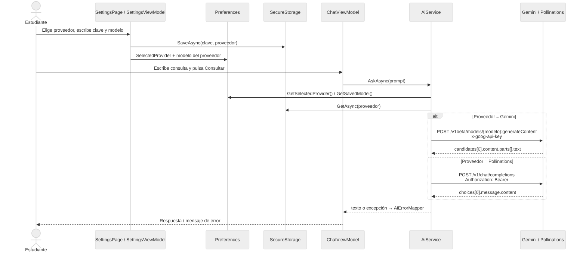

# 7. Arquitectura de proveedores de IA

La aplicación soporta **Google Gemini** y **Pollinations**; el usuario cambia de proveedor **manualmente** en Configuración.

*Figura 3. Selección del proveedor y envío de la consulta.*

## 7.1 Diseño

| Pieza | Archivo | Función |
|---|---|---|
| `AiProvider` (enum) | `Models/AiProvider.cs` | `Gemini = 0`, `Pollinations = 1`. |
| `AiProviderInfo` | `Models/AiProvider.cs` | Datos de cada proveedor: nombre, endpoint, modelo por defecto, modelos sugeridos, encabezado de clave, clave en SecureStorage y preferencia del modelo. |
| `AiProviderCatalog` | `Models/AiProvider.cs` | Lista de proveedores, `Parse` (valor guardado → enum, con Gemini como respaldo), `NormalizeModel`, `BuildEndpoint`. |
| `AiService` | `Services/AiService.cs` | `AskAsync` hace las validaciones comunes y llama a `AskGeminiAsync` o `AskPollinationsAsync`. |
| `ChatModels` | `Models/ChatModels.cs` | DTO de Gemini (`ChatRequest`/`ChatResponse`) y de OpenAI/Pollinations (`OpenAiChatRequest`/`OpenAiChatResponse`). |
| `SettingsViewModel` / `SettingsPage` | `ViewModels`, `Views` | Selector de proveedor, modelos, clave, *Probar conexión*. |

## 7.2 Características de cada proveedor

| Aspecto | Google Gemini | Pollinations |
|---|---|---|
| Endpoint | `/v1beta/models/{modelo}:generateContent` | `/v1/chat/completions` |
| Formato | Propio de Google (`contents`, `parts`) | Compatible con OpenAI (`messages`) |
| Autenticación | `x-goog-api-key` | `Authorization: Bearer` |
| Modelo por defecto | `gemini-3.5-flash-lite` | `openai` |
| Modelos sugeridos | `gemini-3.5-flash-lite`, `gemini-3.1-flash-lite`, `gemini-3.6-flash`, `gemini-3.8-flash` | `openai`, `openai-fast`, `mistral` (lista vigente en `gen.pollinations.ai/models`) |
| Obtener clave | Google AI Studio | enter.pollinations.ai |
| Respuesta | `candidates[0].content.parts[].text` | `choices[0].message.content` |

## 7.3 Selección y cambio manual

1. En **Perfil › Configuración**, el usuario elige el proveedor en el selector «Proveedor de IA».
2. Al cambiar el selector se cargan los modelos sugeridos y el estado de la clave **de ese proveedor**; aún no se usa en las consultas.
3. Al pulsar **Guardar** se guarda la clave (si se escribió una), el modelo en su preferencia (`SelectedModel` o `SelectedModel_Pollinations`) y el proveedor en `SelectedProvider`.
4. **Probar conexión** prueba el proveedor del selector aunque no se haya guardado.
5. Desde ese momento `ChatViewModel` muestra «Consultando {proveedor}…» y `AiService` usa el proveedor guardado. Cada proveedor conserva su propia clave y modelo, por lo que se puede alternar sin volver a escribirlos.

No hay cambio automático (*fallback*): si un proveedor falla, el mensaje de error sugiere cambiarlo manualmente. Así el usuario siempre sabe a qué servicio se envía su texto.

## 7.4 Cómo agregar otro proveedor

1. Agregar el valor al enum `AiProvider` y una entrada `AiProviderInfo` en `AiProviderCatalog` (endpoint, encabezado, claves).
2. Si usa formato OpenAI, reutilizar `AskPollinationsAsync` (o generalizarlo); si no, crear `AskXxxAsync` y sus DTO.
3. Agregar el caso en el `switch` de `AiService.AskAsync`.
4. Agregar pruebas en `AiProviderCatalogTests`. Las vistas no cambian.
