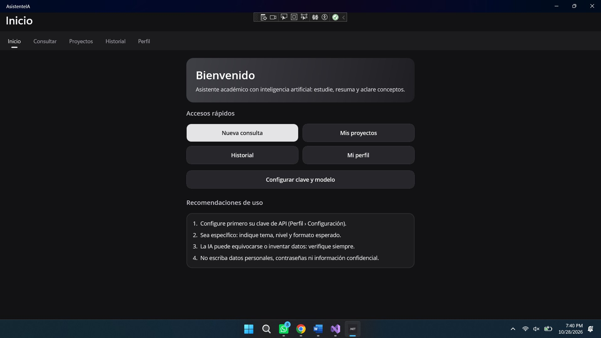
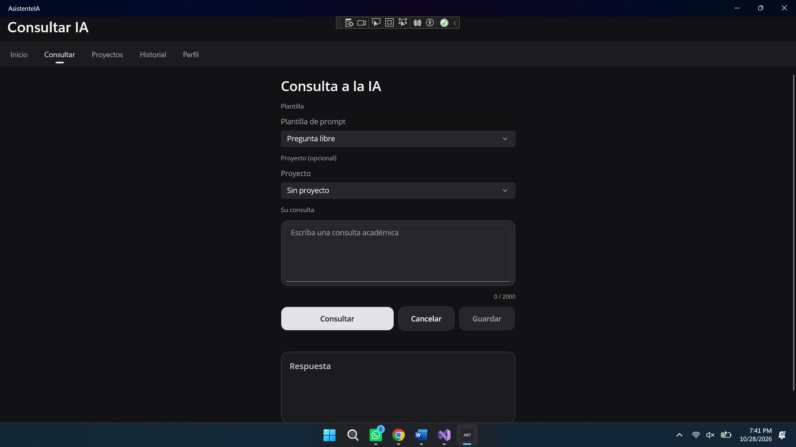
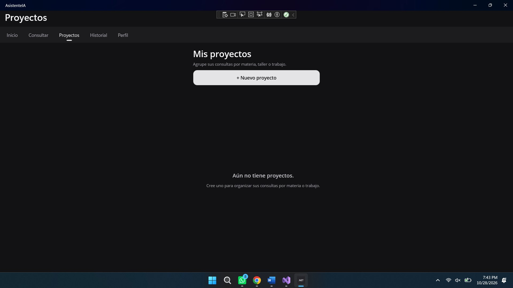
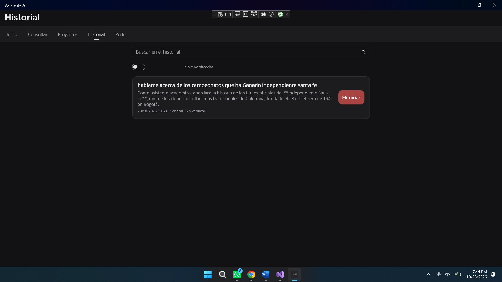
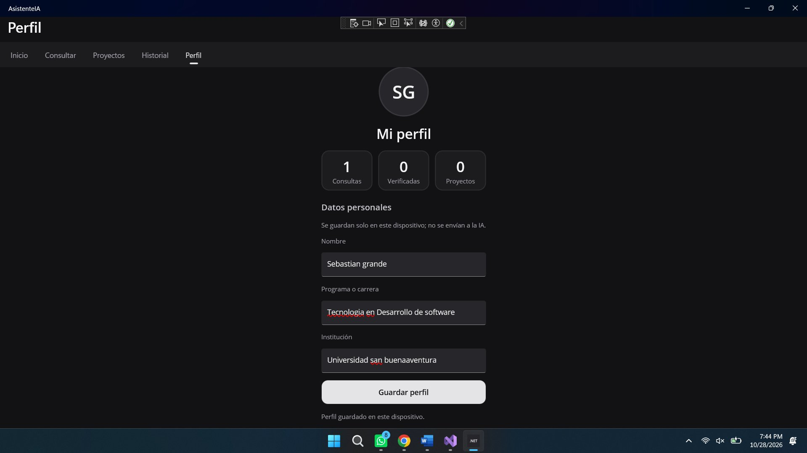
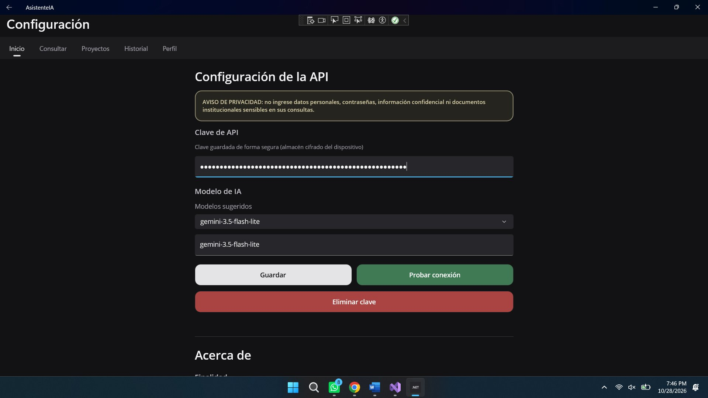
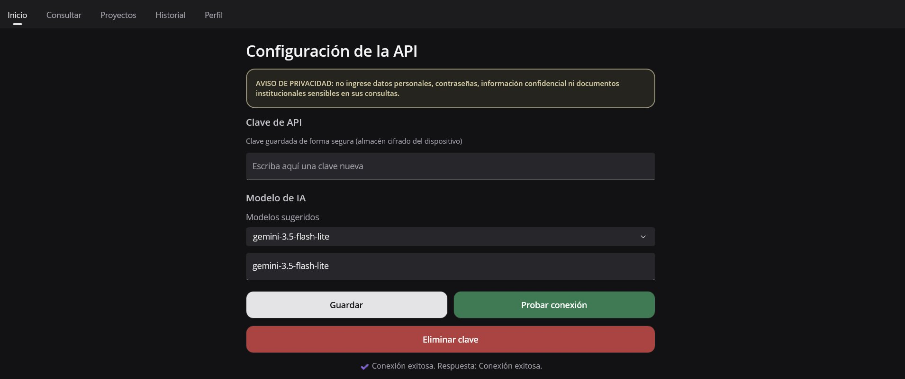

# 8. Interfaz de la aplicación

La aplicación usa un tema oscuro («Grafito») con tarjetas y navegación por pestañas. Las capturas corresponden a la
ejecución en Windows.

## 8.1 Pantalla de inicio

Presenta el propósito de la aplicación, accesos rápidos a las demás pantallas y recomendaciones de uso, incluida la
advertencia de verificar las respuestas y no escribir datos personales. La primera vez muestra el aviso «Uso
responsable de la IA».

*Figura 4. Pantalla de inicio.*

## 8.2 Pantalla de consulta

Permite elegir una plantilla de prompt y, opcionalmente, un proyecto; captura la consulta (con contador de 2000
caracteres) y muestra la respuesta. Incluye los botones Consultar, Cancelar y Guardar. Mientras consulta muestra
«Consultando {proveedor}…».

*Figura 5. Pantalla de consulta.*

## 8.3 Pantalla de proyectos

Agrupa las consultas por materia, taller o trabajo. Cuando no hay proyectos muestra un mensaje que invita a crear el
primero. Al abrir un proyecto se muestra el **Detalle de proyecto**: nombre (3–60 caracteres), descripción
(máx. 300), sus consultas y los botones *Guardar proyecto*, *Consultar en este proyecto* y *Eliminar proyecto*.

*Figura 6. Pantalla de proyectos.*

## 8.4 Pantalla de historial

Lista las consultas guardadas con fecha, categoría, proyecto y estado de verificación. Ofrece búsqueda, filtro
«Solo verificadas» y eliminación. Al tocar una consulta se abre el **Detalle de consulta**, donde se puede marcar como
verificada, escribir una nota personal (máx. 500) y eliminarla.

*Figura 7. Pantalla de historial.*

## 8.5 Pantalla de perfil de usuario

Muestra contadores de consultas, verificadas y proyectos, y permite guardar nombre, programa e institución. Estos
datos se almacenan solo en el dispositivo y no se envían a la IA. Incluye *Borrar historial de consultas* y
*Borrar todos mis datos locales*.

*Figura 8. Pantalla de perfil de usuario.*

## 8.6 Pantalla de configuración de la API

Permite elegir el **proveedor de IA** (Google Gemini o Pollinations), registrar la clave en un campo oculto, elegir o
escribir el modelo, probar la conexión y eliminar la clave. La línea «Proveedor activo» indica qué proveedor y modelo
usan las consultas. Incluye el aviso de privacidad y la sección «Acerca de» (finalidad, autoría, fuentes, privacidad
y límites). La clave no se muestra en pantalla.

*Figura 9. Pantalla de configuración de la API (clave oculta). El selector «Proveedor de IA» se ubica sobre el campo de la clave.*

## 8.7 Conexión de la clave de API

El botón «Probar conexión» realiza una consulta breve al proveedor seleccionado y muestra el resultado.

*Figura 10. Conexión de la API exitosa desde la pantalla de configuración.*
