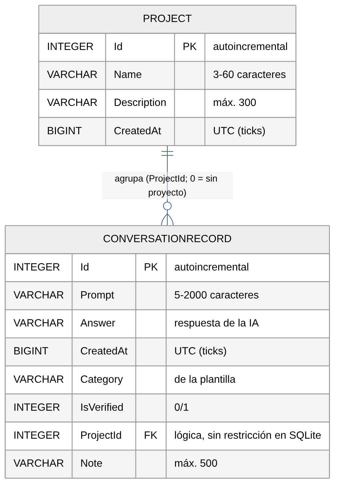

# 11. Persistencia con SQLite

`DatabaseService` inicializa una `SQLiteAsyncConnection` en la carpeta de datos de la aplicación
(`FileSystem.AppDataDirectory`) y crea las tablas a partir de las entidades `ConversationRecord` y `Project`.

## 11.1 Modelo entidad-relación



*Figura 12. Modelo entidad-relación (fuente editable: `diagramas/fuentes/erd.mmd`).*

- **Base de datos:** archivo `AsistenteIA.db3` en `FileSystem.AppDataDirectory` (carpeta privada de la app).
- **Biblioteca:** `sqlite-net-pcl` 1.9.172 con `SQLitePCLRaw.bundle_green` 2.1.10. Las tablas se crean con `CreateTableAsync<T>()`, que también agrega columnas nuevas a bases existentes.

### Tablas

| Tabla | Clave primaria | Claves foráneas | Descripción |
|---|---|---|---|
| `Project` | `Id` (INTEGER, autoincremental) | — | Materia, taller o trabajo que agrupa consultas. |
| `ConversationRecord` | `Id` (INTEGER, autoincremental) | `ProjectId → Project.Id` (**lógica**) | Consulta guardada con su respuesta. |

### Relación

| Relación | Cardinalidad | Regla |
|---|---|---|
| `Project` agrupa `ConversationRecord` | 1 : 0..* | `ProjectId = 0` significa «sin proyecto». |

**Integridad referencial:** sqlite-net no crea restricciones `FOREIGN KEY`. La integridad la mantiene `DatabaseService.DeleteProjectAsync`: antes de borrar un proyecto ejecuta `UPDATE ConversationRecord SET ProjectId = 0 WHERE ProjectId = ?`, así las consultas se conservan sin proyecto.

### SQL equivalente (generado por sqlite-net)

```sql
CREATE TABLE "Project" (
  "Id" INTEGER PRIMARY KEY AUTOINCREMENT NOT NULL,
  "Name" VARCHAR, "Description" VARCHAR, "CreatedAt" BIGINT);

CREATE TABLE "ConversationRecord" (
  "Id" INTEGER PRIMARY KEY AUTOINCREMENT NOT NULL,
  "Prompt" VARCHAR, "Answer" VARCHAR, "CreatedAt" BIGINT,
  "Category" VARCHAR, "IsVerified" INTEGER, "ProjectId" INTEGER, "Note" VARCHAR);
```

## 11.2 Diccionario de datos

> Las longitudes las valida la aplicación (ViewModels y `PromptValidator`); en SQLite las columnas `VARCHAR` no tienen límite.
> `DateTime` se guarda como *ticks* (`BIGINT`), que es el comportamiento por defecto de sqlite-net.

### Tabla `ConversationRecord` (historial)

| Campo | Tipo C# | Tipo SQLite | Restricciones | Valor por defecto | Función |
|---|---|---|---|---|---|
| `Id` | `int` | INTEGER | PK, autoincremental, no nulo | asignado por SQLite | Identificador. `0` = registro nuevo (insertar). |
| `Prompt` | `string` | VARCHAR | 5–2000 caracteres (`PromptValidator`) | `""` | Consulta enviada a la IA. |
| `Answer` | `string` | VARCHAR | — | `""` | Respuesta recibida. |
| `CreatedAt` | `DateTime` | BIGINT | UTC | `DateTime.UtcNow` | Fecha; se muestra en hora local (`dd/MM/yyyy HH:mm`). |
| `Category` | `string` | VARCHAR | Categoría de la plantilla | `"General"` | Explicación, Resumen, Comparación, Estudio, Programación… |
| `IsVerified` | `bool` | INTEGER (0/1) | — | `false` | El estudiante contrastó la respuesta. |
| `ProjectId` | `int` | INTEGER | FK lógica a `Project.Id`; `0` = sin proyecto | `0` | Agrupa la consulta. |
| `Note` | `string` | VARCHAR | máx. 500 caracteres | `""` | Nota personal editable en el detalle. |
| `ProjectName`, `CreatedAtLocal`, `VerificationText`, `MetaText` | `string` | — (`[Ignore]`) | No se guardan | — | Solo presentación. |

### Tabla `Project`

| Campo | Tipo C# | Tipo SQLite | Restricciones | Valor por defecto | Función |
|---|---|---|---|---|---|
| `Id` | `int` | INTEGER | PK, autoincremental | asignado por SQLite | Identificador. |
| `Name` | `string` | VARCHAR | 3–60 caracteres, obligatorio | `""` | Nombre del proyecto. |
| `Description` | `string` | VARCHAR | máx. 300 caracteres | `""` | Contexto que se envía a la IA (máx. 400 caracteres incluido el nombre). |
| `CreatedAt` | `DateTime` | BIGINT | UTC | `DateTime.UtcNow` | Fecha de creación. |
| `ConversationCount`, `CountText`, `DescriptionText` | — | — (`[Ignore]`) | No se guardan | — | Presentación. |

### `Preferences` (preferencias del dispositivo, sin cifrar)

| Clave | Tipo | Ejemplo | Función |
|---|---|---|---|
| `SelectedProvider` | string | `Gemini` / `Pollinations` | Proveedor activo (cambio manual). |
| `SelectedModel` | string | `gemini-3.5-flash-lite` | Modelo de Gemini. |
| `SelectedModel_Pollinations` | string | `openai` | Modelo de Pollinations. |
| `profile_name`, `profile_program`, `profile_institution` | string (máx. 60) | — | Perfil del estudiante (no se envía a la IA). |
| `responsible_use_notice_accepted` | bool | `true` | El aviso de uso responsable ya se mostró. |

### `SecureStorage` (cifrado por el sistema operativo)

| Clave | Contenido |
|---|---|
| `ai_api_key` | Clave de Google Gemini (nombre original, conserva claves guardadas antes). |
| `pollinations_api_key` | Clave de Pollinations. |

## 11.3 Operaciones CRUD

| Operación | Dónde se realiza | Método | Evidencia |
|---|---|---|---|
| Crear consulta | Botón *Guardar* de Consultar | `DatabaseService.SaveAsync` (inserta si `Id = 0`) | Prueba P07 |
| Consultar | Historial (búsqueda y filtro), Detalle de proyecto, Perfil (estadísticas) | `GetItemsAsync`, `GetItemsByProjectAsync`, `GetStatsAsync` | Pruebas P07–P09 |
| Actualizar consulta | *Marcar como verificada* y *Guardar nota* en el detalle | `SaveAsync` (actualiza si `Id ≠ 0`) | Prueba P14 |
| Eliminar consulta | *Eliminar* con confirmación (historial o detalle) | `DeleteAsync` | Prueba P08 |
| Crear / actualizar proyecto | *Guardar proyecto* | `SaveProjectAsync` | Prueba P13 |
| Eliminar proyecto | *Eliminar proyecto* (sus consultas quedan sin proyecto) | `DeleteProjectAsync` | Prueba P13 |
| Eliminar todo | *Borrar historial* / *Borrar todos mis datos locales* | `DeleteAllItemsAsync`, `DeleteAllProjectsAsync` | Prueba P15 |
