# 14. Pruebas y calidad

## 14.1 Plan de pruebas manuales

**Dispositivo:** Windows (Windows Machine) · **Responsables:** Juan Carlos Díaz Cifuentes y Sebastián Grande Moreno.

| Caso | Condición y pasos | Resultado esperado | Resultado obtenido | Estado |
|---|---|---|---|---|
| P01 | **Prompt válido y clave válida.** Configurar clave → Consultar «Explica qué es una API REST» | Respuesta visible y estado final correcto | Se consultó «Explica qué es una API REST»; la respuesta se muestra y aparece «Respuesta recibida…». | Cumple (evidencia a) |
| P02 | **Prompt vacío.** Dejar el editor vacío → Consultar | No se envía la solicitud | Mensaje «Escriba una consulta antes de enviar.»; no se realiza la petición. | Cumple (evidencia b) |
| P03 | **Sin conexión.** Desconectar la red → Consultar | La aplicación no se cierra | Mensaje «Sin conexión a internet. Verifique su red e intente de nuevo.» | Cumple (evidencia c) |
| P04 | **Clave inválida.** Guardar una clave falsa → Probar conexión | Error de autorización sin mostrar la clave | «Error de autorización (400): la clave de API no es válida.» La clave no se muestra. | Cumple (evidencia d) |
| P05 | **Tiempo agotado.** Reducir temporalmente el tiempo máximo del HttpClient → Consultar | La espera termina y se puede reintentar | Aparece «Tiempo de espera agotado. Intente de nuevo.»; los botones siguen activos. Luego se restauró a 60 s. | Cumple (evidencia e) |
| P06 | **Cancelar solicitud.** Consultar y pulsar Cancelar | Se cancela sin bloquear la interfaz | Mensaje «Consulta cancelada.»; los botones siguen activos. | Cumple (evidencia f) |
| P07 | **Guardar conversación.** Obtener respuesta → Guardar → Historial | El registro aparece en el historial | La consulta guardada aparece al inicio de la lista del historial. | Cumple (evidencia g) |
| P08 | **Eliminar conversación.** Historial → Eliminar → confirmar | Se solicita confirmación y se actualiza la lista | La lista pasa de 3 a 2 elementos al eliminar la consulta sobre motos. | Cumple (evidencia h) |
| P09 | **Reiniciar la aplicación.** Guardar, cerrar por completo y abrir | El historial permanece | Las consultas guardadas siguen en el historial y aparece también la consulta nueva. | Cumple (evidencia i) |
| P10 | **Pantalla pequeña / ventana estrecha.** Reducir la ventana en Windows o usar un teléfono pequeño | Todos los controles son accesibles (desplazamiento) |  | Por ejecutar |
| P11 | **Datos sensibles.** Escribir «mi correo es a@b.com» → Consultar | Aparece el aviso; *Revisar* cancela el envío |  | Por ejecutar |
| P12 | **Límite de uso.** Enviar 9 consultas en menos de un minuto | La novena muestra «Límite de uso alcanzado…» |  | Por ejecutar |
| P13 | **Proyectos.** Crear, editar y eliminar un proyecto | Los cambios se reflejan; sus consultas siguen en el historial |  | Por ejecutar |
| P14 | **Nota personal.** Editar la nota de una consulta y reabrirla | La nota persiste |  | Por ejecutar |
| P15 | **Borrar todos los datos.** Perfil → Borrar todos mis datos locales | Historial, proyectos y perfil quedan vacíos |  | Por ejecutar |
| P16 | **Cambiar a Pollinations.** Configuración → Pollinations → clave → Guardar → Probar conexión | «✔ Conexión exitosa con Pollinations» |  | Por ejecutar |
| P17 | **Consultar con Pollinations.** Consultar con Pollinations activo | Respuesta visible y «Respuesta recibida de Pollinations» |  | Por ejecutar |
| P18 | **Volver a Gemini.** Seleccionar Gemini → Guardar (sin escribir la clave) → Consultar | Funciona: cada proveedor conserva su clave |  | Por ejecutar |
| P19 | **Cambio sin guardar.** Cambiar el selector sin pulsar Guardar → Consultar | Se sigue usando el proveedor activo |  | Por ejecutar |
| P20 | **Clave inválida en Pollinations.** Guardar una clave falsa de Pollinations → Probar conexión | «Error de autorización (401)…» sin mostrar la clave |  | Por ejecutar |

## 14.2 Evidencias de las pruebas manuales

### a) Consulta informativa exitosa (P01)

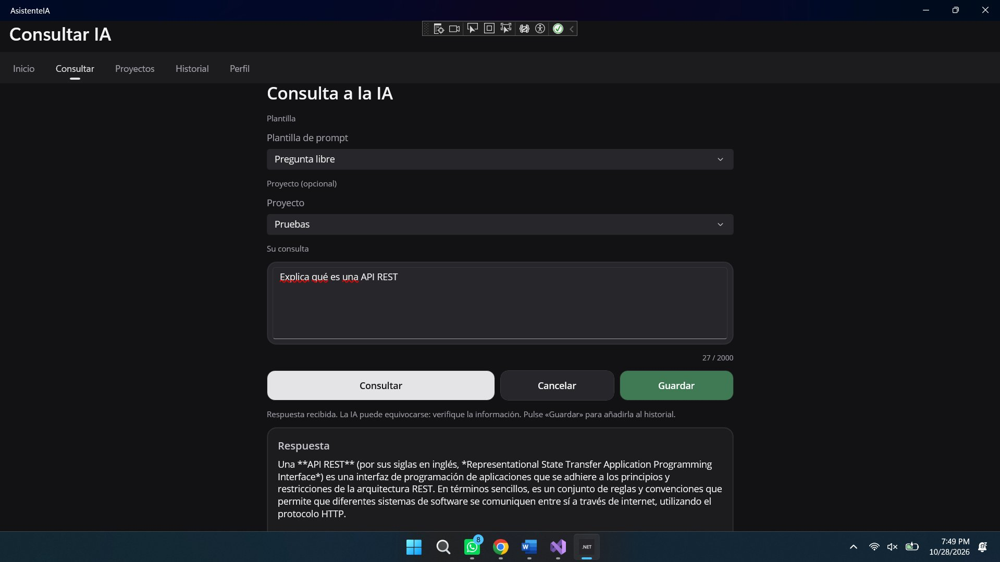

*Figura 13. Consulta informativa exitosa (P01).*

### b) Error si no se escribe nada (P02)

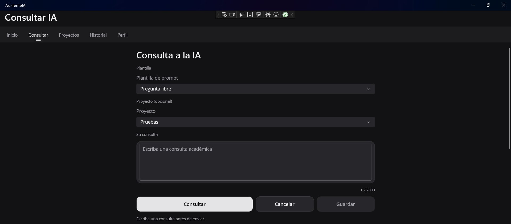

*Figura 14. Validación de consulta vacía (P02).*

### c) Error sin internet (P03)

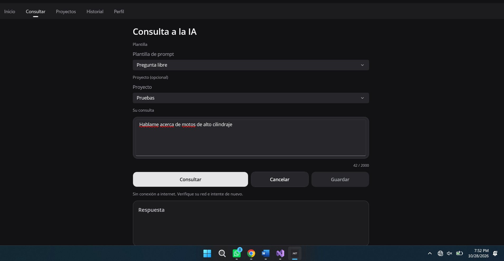

*Figura 15. Prueba de error sin conexión a internet (P03).*

### d) Error con clave de API falsa (P04)

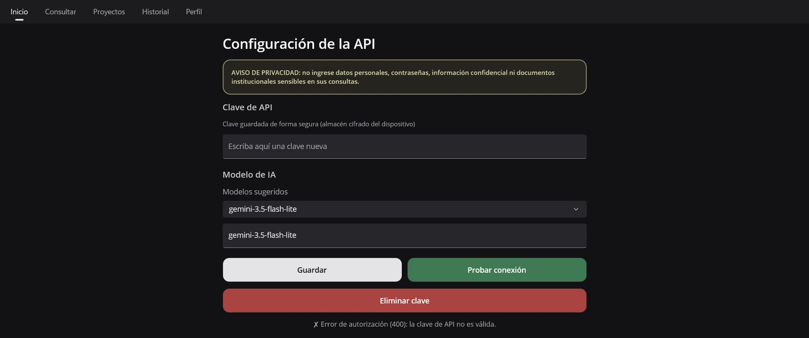

*Figura 16. Prueba de error con clave de API inválida (P04).*

### e) Tiempo de espera agotado (P05)

Para esta prueba se redujo temporalmente el tiempo máximo de espera del HttpClient y luego se restauró a 60 segundos.

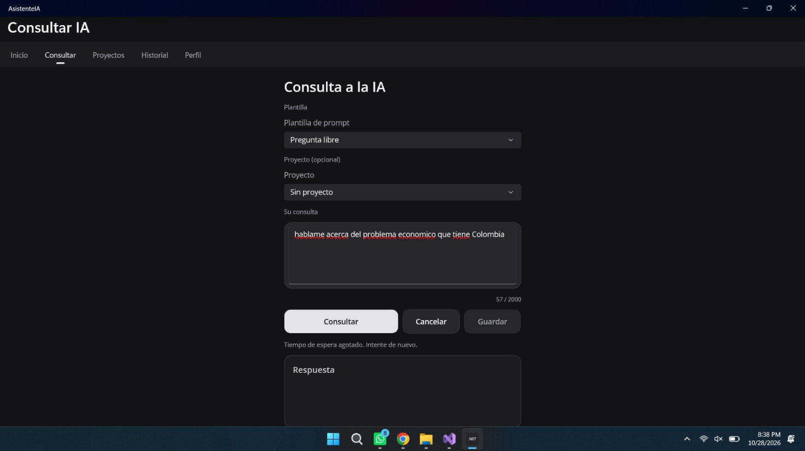

*Figura 17. Prueba de tiempo de espera agotado (P05).*

### f) Consulta cancelada (P06)

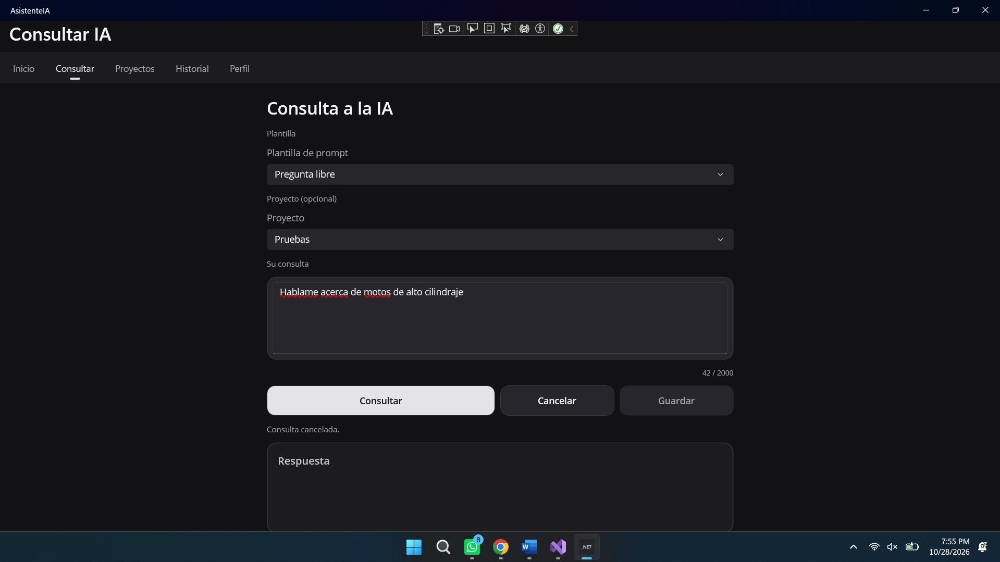

*Figura 18. Prueba de consulta cancelada (P06).*

### g) Historial de consultas (P07)

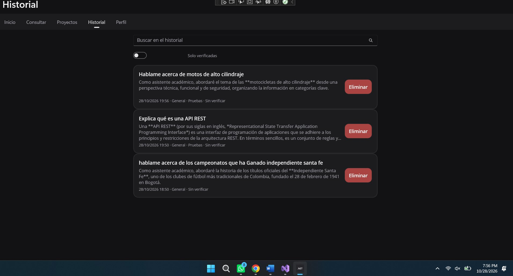

*Figura 19. Historial con tres consultas guardadas (P07).*

### h) Eliminación de una consulta del historial (P08)

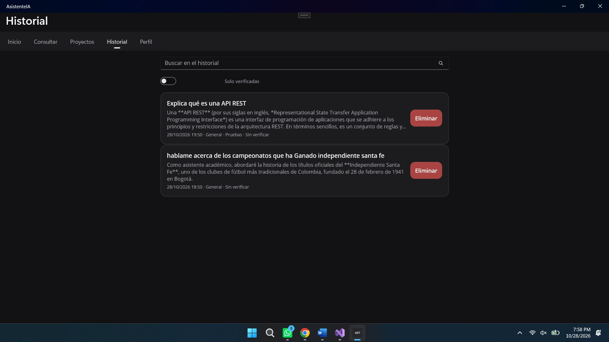

*Figura 20. Historial después de eliminar una consulta (P08).*

### i) Persistencia al reiniciar la aplicación (P09)

El historial antes de cerrar la aplicación y después de volver a abrirla: las consultas anteriores se conservan y
aparece la consulta nueva.

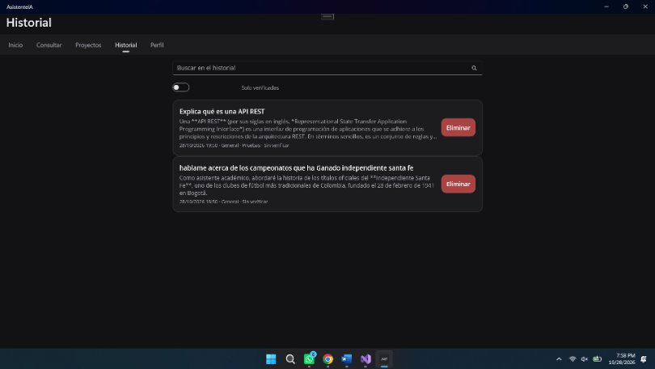

*Figura 21. Historial antes de cerrar la aplicación (P09).*

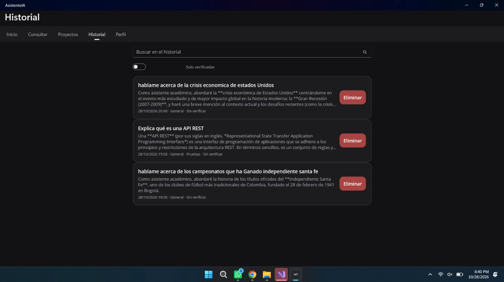

*Figura 22. Historial después de cerrar y volver a abrir la aplicación (P09).*

## 14.3 Pruebas automáticas

El proyecto **AsistenteIA.Tests** (xUnit, `net9.0`) prueba la lógica que no depende de MAUI. Se ejecuta con
*Prueba › Explorador de pruebas › Ejecutar todas* o con `dotnet test AsistenteIA.Tests`.

| Clase | Casos | Qué prueba |
|---|---|---|
| `PromptValidatorTests` | 8 | Vacío, corto, mínimo, máximo y sobre el máximo (apoya P02). |
| `SensitiveDataDetectorTests` | 18 | Correo, tarjeta (Luhn), teléfono, cédula, credenciales, clave de API y falsos positivos (apoya P11). |
| `RequestLimiterTests` | 3 | Permite hasta el límite, bloquea e informa la espera, se libera tras la ventana (apoya P12). |
| `UserProfileTests` | 5 | Iniciales del avatar. |
| `AiProviderCatalogTests` | 16 | Catálogo de proveedores, lectura de la preferencia, modelos, endpoints, clave en encabezado (apoya P16–P19). |
| `AiErrorMapperTests` | 16 | Mensajes para 400, 401, 402, 403, 404, 408, 429, 5xx, sin conexión, tiempo agotado, cancelación y que nunca contienen la clave (apoya P03–P06, P20). |
| **Total** | **66** | |

La Figura siguiente muestra la ejecución en el Explorador de pruebas de Visual Studio de las 34 pruebas de las
cuatro primeras clases: 34 correctas, 0 fallidas, 0 omitidas, duración total 0,5 s. Las 32 pruebas de
`AiProviderCatalogTests` y `AiErrorMapperTests` se agregaron con la integración de Pollinations y se ejecutan con
el mismo comando.

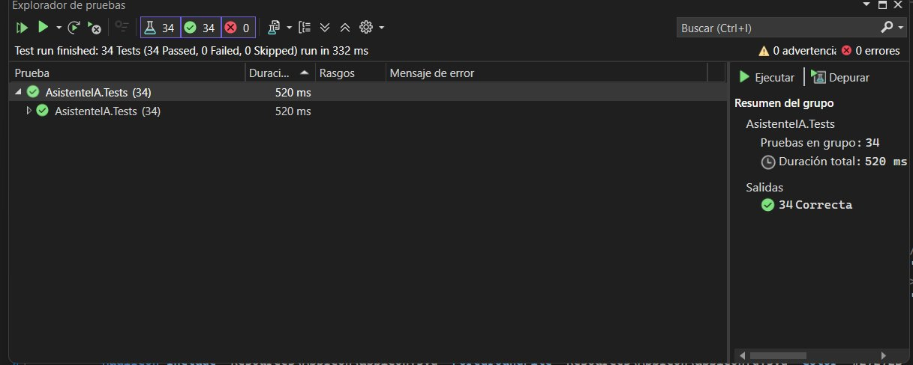

*Figura 23. Resultado de las pruebas automáticas en el Explorador de pruebas.*

Las pruebas automáticas complementan a las manuales: verifican la lógica de forma repetible, sin depender de la
interfaz ni de la conexión.
